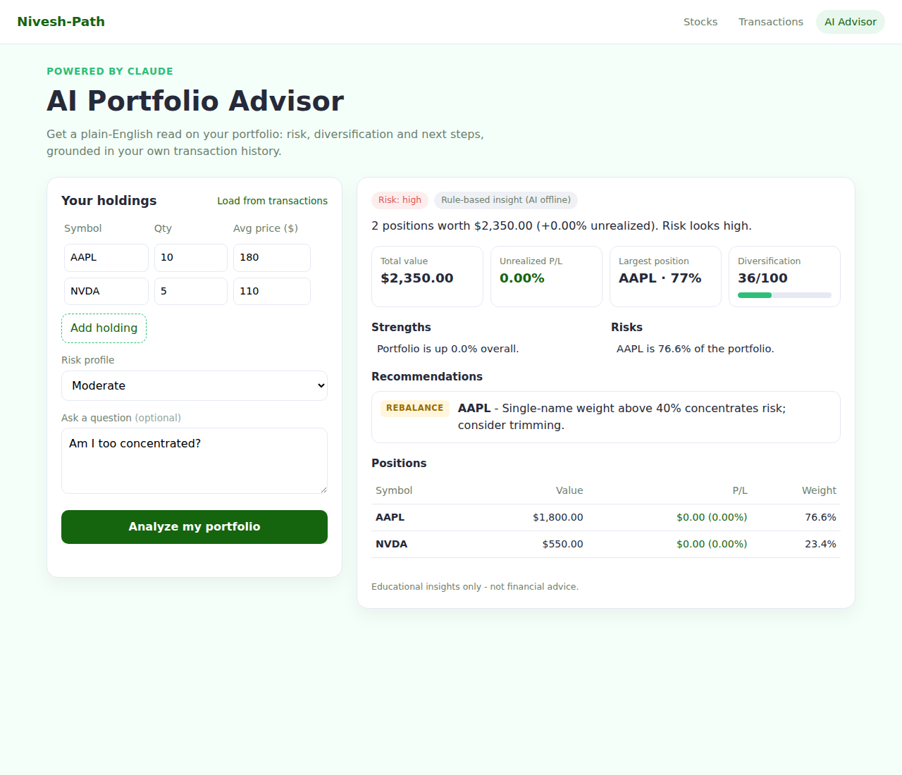

# Nivesh-Path: a paper-trading app that studies your own trading habits

[](https://github.com/sumitparmar19/Nivesh-Path/actions/workflows/ci.yml)

**Live:** https://nivesh-path-vzeak.ondigitalocean.app

Most retail investors don't lose money for lack of information. They lose it to habits: selling in a panic after a
drop, buying after a stock has already run up, putting most of the account into one name. Nivesh-Path ("path to
investment") gives every user **$100,000 of virtual cash** to trade US stocks at live prices, checks every trade for
those habits, and explains the user's patterns with evidence from their own history.



## Features
- **Behavioral Mirror:** every buy and sell is checked for panic selling, FOMO buying and overconcentration, using
  the market data at that moment. The trade panel flags it right away; a dedicated page shows two scores (impulse
  control, diversification), every detected pattern, and an AI coach that cites the user's own trades.
  [How the rules work](docs/BEHAVIORAL_MIRROR.md).
- **Portfolio AI Advisor:** risk level, diversification, strengths, risks, recommendations and answers to free-form
  questions, as schema-validated output from an LLM (Anthropic Claude API). All numbers are computed in code; the LLM
  never does arithmetic. If the LLM is unavailable, a rule-based engine answers from the same metrics.
- **RAG over your history:** each user's trades are embedded into their own ChromaDB collection, and the Advisor
  retrieves the most relevant ones before answering. ChromaDB is a cache, rebuilt from the database on every deploy.
- **A ledger that can't overspend:** cash and trades live in PostgreSQL with NUMERIC money, CHECK constraints and a
  row lock per order (`SELECT … FOR UPDATE`). Orders carry an `Idempotency-Key`, so a retry or a double click never
  buys twice. Moved from MongoDB with a verified, repeat-safe migration. [Ledger design](docs/LEDGER.md).
- **Market data:** 50+ curated stocks and ETFs plus any NYSE/NASDAQ ticker: live quotes, key stats, company profile
  and news from Finnhub, proxied and cached server-side so the API key never reaches the browser. Watchlist.
- **Accounts:** JWT auth with bcrypt; profile, theme, password, saved analyses, paper-account reset and account
  deletion, all stored per user. Every query is filtered by the signed-in user.
- **Observability:** OpenTelemetry traces, metrics and JSON logs from both services to Grafana Cloud; one trade is one
  trace across both; a redacting exporter keeps tokens, keys and emails out. [Details](docs/OBSERVABILITY.md).
- **Nightly job on AWS:** EventBridge Scheduler → Step Functions → Lambda saves the daily close of every held stock
  and re-checks every account for overconcentration, with no database credentials in AWS. [Details](docs/AWS.md).
- **What's new:** release notes plus live system status (database, AI service, ledger).

## Architecture
```
Browser (React) ─▶ Node/Express web :3000 ─▶ PostgreSQL (ledger), MongoDB, Redis, Finnhub
                        │   ▲
                        ▼   │ token-only /internal
                  FastAPI AI service :8001 ─▶ ChromaDB, LLM (Anthropic Claude API)

AWS nightly job ─▶ web /internal/jobs/*        Both services ─▶ Grafana Cloud (OTLP)
```
Diagrams and request flows: [architecture.md](architecture.md).

| Layer | Tech |
|---|---|
| Frontend | React 18, TypeScript, Tailwind, React Router, TanStack Query, Zustand, Recharts (Vite) |
| Backend | Node.js 22, Express, Prisma + PostgreSQL 18, Mongoose + MongoDB, Redis, JWT |
| AI service | Python 3.11, FastAPI, LangChain, Anthropic SDK, ChromaDB, Pydantic |
| Infrastructure | Docker, DigitalOcean App Platform, Neon, MongoDB Atlas, Terraform on AWS (ECS Fargate, ALB, RDS, Step Functions, Lambda), GitHub Actions with OIDC |
| Observability | OpenTelemetry, Grafana Cloud (Tempo, Prometheus, Loki), Sentry |
| Testing | Jest + Supertest (with a real PostgreSQL), pytest, Vitest + Testing Library, Playwright, k6, gitleaks, Checkov |

## Results
Measured, with the source of each number: [docs/RESULTS.md](docs/RESULTS.md).
- **AWS:** under a 50-user k6 test through the load balancer, 95,964 requests at 180.3 requests/s (p95 405.4 ms),
  and web autoscaled from 1 to 3 tasks ([output](docs/aws/LOADTEST_RESULTS.md)).
- **Cache:** read-path p95 9.6 ms with the cache vs 22.3 ms without, at a 99.7% hit rate, 0 errors in about 42,000
  requests ([PERFORMANCE.md](docs/PERFORMANCE.md)).
- **Ledger:** 20 parallel $10,000 buys on a $100,000 account across two app instances: exactly 10 fill, cash ends at
  $0.00. Five copies of one order: one trade.
- **Live site:** the end-to-end smoke test (sign up, trade, every page, delete) passes all 10 steps against
  production.

## Run locally
**Everything with Docker:**
```bash
cp .env.example .env        # add your Finnhub and Anthropic keys (MongoDB, PostgreSQL and Redis run in compose)
docker compose up --build   # http://localhost:3000
```

**Or each service yourself:**
```bash
# AI service
cd ai-service && python -m venv .venv && .venv/bin/pip install -r requirements-dev.txt
.venv/bin/uvicorn main:app --port 8001

# Web API (new terminal, repo root): npm install also generates the Prisma client
npm install && npm run dev

# React app (new terminal): dev server on :5173, API calls proxied to :3000
cd frontend && npm install && npm run dev
# or build once and let Express serve it on :3000
cd frontend && npm run build
```

## Tests
```bash
npm test                          # web API: Jest + Supertest
TEST_DATABASE_URL=... npm test    # plus the PostgreSQL suites (a migrated, disposable database)
cd ai-service && .venv/bin/pytest -q
cd frontend && npm test && npm run typecheck
cd frontend && npm run e2e        # Playwright, against a server started with FAKE_MARKET_DATA=1
```
CI runs all of them on every push, plus Playwright on both ledgers, a Docker build, a full-history secret scan
(gitleaks), and Terraform checks (fmt, validate, Checkov, a plan comment) for `infra/`.

## API highlights
| Method | Path | Description |
|---|---|---|
| POST | `/api/register` · `/api/login` · GET `/api/me` | Auth (JWT) |
| POST | `/api/store-purchase` (alias `/api/trades`) | Buy or sell `{symbol, quantity, type}` with an optional `Idempotency-Key` header; priced server-side; the response includes any detected `behavior` |
| GET | `/api/transactions` · `/api/portfolio/holdings` · `/api/portfolio/cash-balance` | Your trades, holdings, cash and P&L |
| POST | `/api/ai/analyze-portfolio` | AI analysis of your portfolio (rate-limited) |
| GET/POST | `/api/patterns`, `/api/patterns/summary`, `/api/patterns/analyze` | Behavioral Mirror: patterns, scores, AI coach |
| GET | `/api/stocks/:symbol/quote\|profile\|metrics\|news`, `/api/stocks/search?q=` | Cached market data |
| GET | `/api/status` | Public system status |

All trade, portfolio and AI routes require `Authorization: Bearer <jwt>`. The AI service has interactive docs at
`http://localhost:8001/docs`.

## Documentation
| Doc | What |
|---|---|
| [architecture.md](architecture.md) | Components, request flows, persistence, deployment |
| [docs/BEHAVIORAL_MIRROR.md](docs/BEHAVIORAL_MIRROR.md) | Detection rules, thresholds, scores, rule versions, bugs fixed |
| [docs/LEDGER.md](docs/LEDGER.md) | Ledger design, concurrency, idempotency, the MongoDB → PostgreSQL migration |
| [docs/RESULTS.md](docs/RESULTS.md) | Every measured result and where it came from |
| [docs/PERFORMANCE.md](docs/PERFORMANCE.md) | k6 load tests in CI: cache on vs off |
| [docs/aws/LOADTEST_RESULTS.md](docs/aws/LOADTEST_RESULTS.md) | The AWS load test and autoscaling timeline |
| [docs/OBSERVABILITY.md](docs/OBSERVABILITY.md) | OpenTelemetry, metrics, privacy, alerts |
| [docs/AWS.md](docs/AWS.md) | The AWS demo stack and nightly job: architecture, security model, costs |
| [docs/DEPLOYMENT.md](docs/DEPLOYMENT.md) | Keys and deploying your own copy |
| [docs/RUNBOOK.md](docs/RUNBOOK.md) | Operating the live system |
| [docs/LEDGER_CUTOVER.md](docs/LEDGER_CUTOVER.md) | The ledger cutover procedure |

---
Built by **Sumit Parmar**. Paper trading only: no real money, taxes or fees. Insights are educational, not financial
advice.
