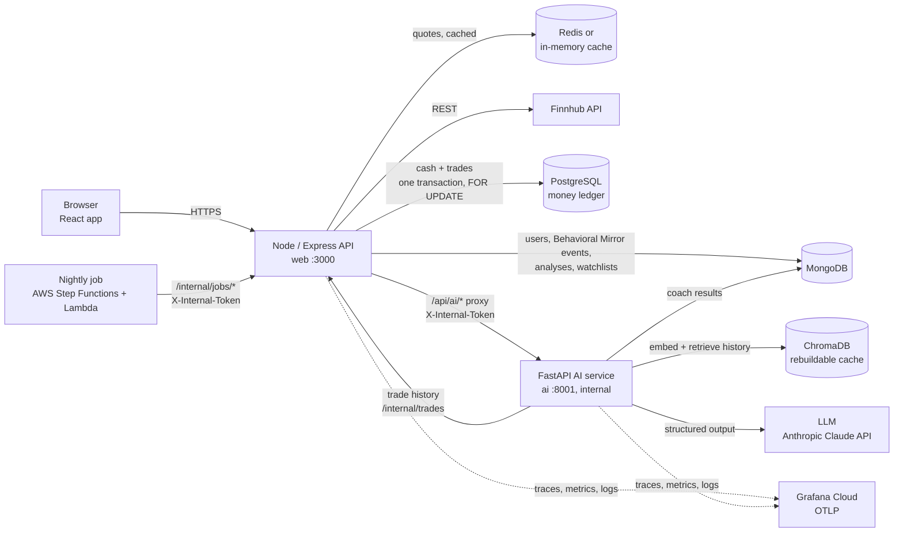
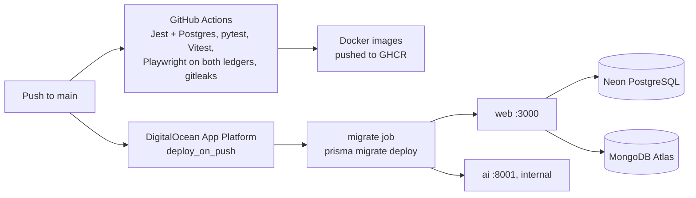

# Nivesh-Path architecture

| Part | Code | Notes |
|---|---|---|
| React app | `frontend/` (React 18, TypeScript, Tailwind, TanStack Query, Zustand) | Built by Vite and served by Express (`src/spa.js`); legacy URLs 301 to React routes; `REACT_DISABLED` rolls a route back to the legacy page in `public/` |
| Web API | `server.js`, `src/app.js`, `src/routes/*` | JWT auth on every trade, portfolio and AI route; every query is filtered by the caller's user id |
| Ledger | `src/lib/ledger.js` → `src/lib/ledgerStore.pg.js` (Prisma) | [`docs/LEDGER.md`](docs/LEDGER.md) |
| Behavioral Mirror | `src/lib/behaviorRules.js`, `behaviorDetector.js`, `src/routes/patterns.js` | [`docs/BEHAVIORAL_MIRROR.md`](docs/BEHAVIORAL_MIRROR.md) |
| Market data | `src/lib/quotes.js`, `src/lib/marketData.js`, `src/lib/cache.js` | Finnhub through the server only, so the key never reaches the browser |
| AI service | `ai-service/` (FastAPI, LangChain, Anthropic SDK, ChromaDB) | Internal only; with `AI_INTERNAL_TOKEN` set it answers only the web service |
| Internal API | `src/routes/internal.js` | Token-only (404 otherwise): read-only trade history for the AI service; the nightly job's routes |
| Observability | `src/telemetry.js`, `src/lib/metrics.js`, `src/lib/logger.js`, `ai-service/telemetry.py` | Off unless `OTEL_EXPORTER_OTLP_ENDPOINT` is set ([`docs/OBSERVABILITY.md`](docs/OBSERVABILITY.md)) |
| Infrastructure | `.do/app.yaml`, `infra/` (Terraform) | DigitalOcean is the live site; AWS hosts the nightly job and an on-demand demo stack ([`docs/AWS.md`](docs/AWS.md)) |

## Placing an order

1. The trade panel sends `POST /api/store-purchase` with `{symbol, quantity, type}` and an `Idempotency-Key` header.
2. `ledger.js` validates it (whole shares, a known ticker) and prices it from the live quote (Finnhub, cached).
3. The PostgreSQL store runs one transaction: lock the account row (`SELECT … FOR UPDATE`), check cash or shares,
   insert the trade, update cash. CHECK constraints refuse negative cash or quantities. A repeated key returns the
   original trade.
4. The Behavioral Mirror detector checks the trade for a panic sell, a FOMO buy and overconcentration. The response
   waits for it at most 1.5 s; detection never fails a trade.
5. The trade is sent to the AI service, which embeds it into the user's ChromaDB collection for later analyses.

## Portfolio AI Advisor

1. The Advisor page loads holdings (`GET /api/portfolio/holdings`, derived from trades) and posts them with a risk
   profile and an optional question to `POST /api/ai/analyze-portfolio`. The route is rate-limited because every call
   costs LLM tokens.
2. Node adds live prices and the cash balance, then forwards the request to the AI service.
3. The AI service:
   - computes the metrics in Python: P/L, weights as shares of the whole account (cash included), concentration and
     diversification. The LLM never does arithmetic;
   - retrieves the user's most relevant past trades from ChromaDB (RAG);
   - builds the prompt with a LangChain `ChatPromptTemplate` and calls the LLM (Anthropic Claude API) with structured
     output validated against the `AIInsight` Pydantic schema. The prompt says the account is paper trading;
   - overwrites the diversification score with the computed one;
   - if the LLM is unavailable (no key, outage, rate limit, refusal), returns a rule-based insight instead, so the page
     always works.
4. Every analysis is saved and can be reopened from the Advisor's history.

## Persistence: why ChromaDB can be thrown away

App Platform wipes the container filesystem on every deploy, so ChromaDB is only a cache. The databases are the
source of truth:
- On boot, `ai-service/startup.py` re-embeds every user's trades (read from web's token-only `/internal/trades` API)
  into that user's own Chroma collection, in a background thread. Progress is on the AI service's `/health` and on
  What's new.
- If a user's collection is still missing when they ask the Advisor, it is rebuilt for that user on the spot.
- Coach results and per-type pattern summaries are stored in MongoDB's `behavioral_patterns` collection, never only
  in Chroma.

## Deployment

The pre-deploy `migrate` job applies new PostgreSQL migrations first; if it fails, the deploy stops and the running
version stays up. Infrastructure changes under `infra/` get `terraform fmt`/`validate`, Checkov, ShellCheck and a
plan comment on every pull request (`.github/workflows/infra.yml`).
