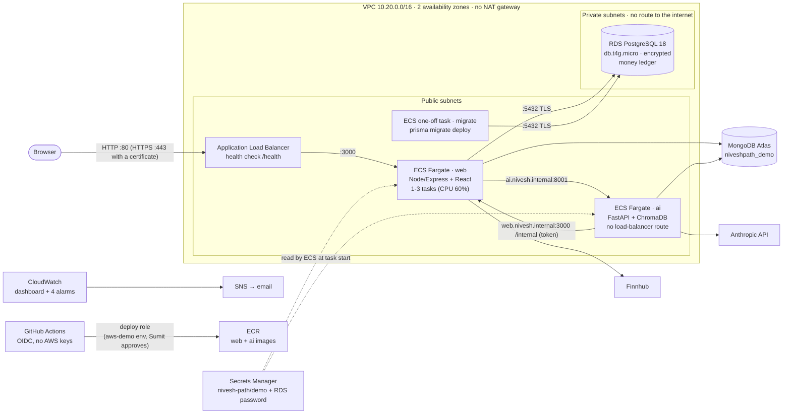
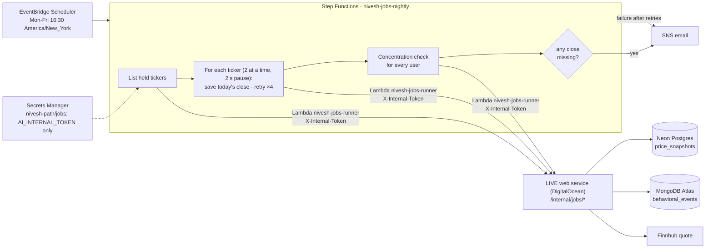

# AWS: the demo stack and how to run it

Phase 3, Part 2 (PR E). The whole app can be created on AWS with Terraform for a demo or a load test, and then destroyed. **DigitalOcean stays the always-on live site.** Nothing here touches it.

| Folder | What | Lifetime |
|---|---|---|
| `infra/bootstrap/` | State bucket, GitHub sign-in (OIDC) + two roles, the permissions boundary, two empty secrets, the alert email topic | Created once by Sumit in CloudShell; never destroyed by the workflows |
| `infra/demo/` | VPC, load balancer, ECS Fargate (web + ai), RDS Postgres, ECR, CloudWatch dashboard + 4 alarms | Created for a demo, then destroyed |
| `infra/jobs/` | The nightly job (PR F) | Always on, costs cents |

The workflows are under GitHub → **Actions**:
- **Infra:** automatic on PRs: checks plus a plan comment.
- **AWS demo: apply + deploy**
- **AWS demo: deploy**
- **AWS demo: load test**
- **AWS demo: destroy**

---

## 1. Architecture



**How a request flows:**
1. A browser reaches the load balancer, which forwards it to a **web** task.
2. web calls **ai** by private DNS name (Cloud Map), and ai calls web's token-only `/internal` API for trade history.
3. Money lives in **RDS**, which only web (and the migration task) can reach.
4. Users, Behavioral Mirror events and AI memory stay in **MongoDB Atlas**, in a separate demo database. That's the same split as the live site.

**What is deliberately different from the live site:**
- **Ledger database:** RDS instead of Neon.
- **Cache:** in-memory per task, with no Redis (cheapest, and it keeps the stack self-contained).
- **Status panel:** What's new says **"Hosted on: AWS (demo stack, temporary)"** and **"PostgreSQL (AWS RDS)"**, so no one confuses it with the live site.

## 2. The NAT gateway trade-off

**A NAT gateway costs about $32/month** plus data charges, even when idle. It's the usual way for private-subnet tasks to reach the internet: for ECR images, CloudWatch logs, MongoDB Atlas, Finnhub and Anthropic.

**This stack has no NAT:**
- **Tasks run in public subnets with public IPs.** The public IP is only their way *out*.
- **Inbound is blocked by security groups:**
  - web accepts port 3000 only from the load balancer and from ai;
  - ai accepts port 8001 only from web.
  - Nobody on the internet can connect to a task directly.
- **RDS is in private subnets** whose route table has only the VPC-local route. It has no public address, and its security group accepts 5432 only from web tasks.

**What it costs instead:**
- **Public IPv4 charges:** each task's public IP is $0.005/hour, as are the load balancer's two (§6).
- **Defence in depth relies on security groups alone.** Nothing checks network-level egress: a compromised task could connect anywhere.

**The production answer** is private subnets for tasks, plus a NAT gateway or VPC endpoints for ECR, logs and Secrets Manager (about $7/month each), plus egress rules. For a stack that exists for a few hours per demo, that's about $1 a day spent on nothing.

**Interview version:** *"I traded network-level isolation of the tasks for about $32/month, kept the database fully private, and made security groups the inbound boundary. In production I'd move tasks to private subnets behind a NAT or endpoints."*

## 3. Security model

**No AWS access keys exist anywhere.**
- GitHub Actions signs in with **OIDC**: each job gets a short-lived token from GitHub, which AWS exchanges for temporary credentials.
- **Two roles**, because GitHub's token for an *environment* job doesn't say which branch it ran on, and a *pull request* job can't use the environment:

| Role | Who can use it | Can do |
|---|---|---|
| `github-nivesh-deploy` | Only jobs in the `aws-demo` environment (`repo:sumitparmar19/Nivesh-Path:environment:aws-demo`). GitHub restricts that environment to `main` and requires Sumit's approval | Create, change and delete the demo and jobs stacks |
| `github-nivesh-plan` | Pull request jobs of this repository (`…:pull_request`; forks get no token) | Read-only (`ReadOnlyAccess`). Explicitly **denied** secret values, parameters, decrypt, Lambda code, log contents, and objects outside the state bucket |

**The deploy role is fenced in three ways** (`infra/bootstrap/deploy_policy.tf`):
1. **Only the services these stacks use, only in `us-east-1`.**
2. **IAM is limited to roles named `nivesh-demo-*` / `nivesh-jobs-*`, and only if they carry the `nivesh-workload-boundary` permissions boundary:**
   - It can't remove or change that boundary.
   - It can't attach managed policies, create users or access keys, or edit itself (its own name doesn't match the pattern).
   - So even a tampered workflow can't create a role that does more than the boundary allows: pull images, write logs, read the two `nivesh-path/*` secrets and the RDS password, and run the nightly job.
3. **It never reads secret values.** The ECS *execution role* does that when a task starts, and only for the demo secret and the RDS password.

**Secrets:**
- `nivesh-path/demo` and `nivesh-path/jobs` are created **empty** by Terraform, and Sumit types the values in the console. So the values are never in Terraform state, Git or a workflow log.
- **Nobody types the RDS password.** RDS generates it and keeps it in Secrets Manager (`manage_master_user_password`).
- ECS passes it to the containers as `DB_USER`/`DB_PASSWORD`, and `src/lib/dbUrl.js` builds the connection URL with every part percent-encoded.
- The database connection uses TLS (`sslmode=require`; RDS refuses unencrypted connections).

**Two roles per container:**
- The **execution role** starts the task.
- The **task role** is what the code can call in AWS. Both task roles have **no permissions**, because the app needs no AWS API.

**Checks on every PR touching `infra/`** (`.github/workflows/infra.yml`):
- `terraform fmt` and `validate`;
- **Checkov** (security scan): every finding is either fixed or skipped *in the code* with a written reason;
- one **custom Checkov rule** (`infra/checkov/`): every role the stacks create carries the boundary;
- ShellCheck on the scripts;
- `terraform plan` posted as a PR comment, made with the read-only role and no state lock.

## 4. Runbook (Sumit, all in a browser)

Never paste a password, key or connection string into any chat. They go only into the AWS, Atlas or GitHub screens named below.

### 4.1 Once: account and bootstrap

**B1. AWS account:**
- Sign up on the **Free plan**.
- Turn on **MFA for the root user** (IAM → Security credentials).
- Create **budgets at $10 and $25** (Billing → Budgets → Create → "Monthly cost budget", with your email).
- Create an admin user for daily use: IAM Identity Center, or IAM → Users with `AdministratorAccess`. Sign in with that, not root.
- Choose region **US East (N. Virginia) `us-east-1`** (top right).

**B2. Bootstrap in CloudShell:**
- Check the console's region (top right) says **US East (N. Virginia)**. CloudShell inherits it, and the script refuses any other region.
- Click the CloudShell icon (`>_`, top bar) and paste:
  ```
  git clone --depth 1 https://github.com/sumitparmar19/Nivesh-Path.git ~/Nivesh-Path
  bash ~/Nivesh-Path/infra/bootstrap/cloudshell.sh
  ```
- **It asks for the email for alarm emails, shows the plan, and waits for you to type `yes`.**
- At the end it prints three lines: `AWS_ROLE_ARN`, `AWS_PLAN_ROLE_ARN`, `AWS_REGION`. These are not secret.
- What the script does:
  - stops unless the region is `us-east-1`;
  - installs Terraform 1.15.9 (checksum-verified), and keeps its provider downloads in `/tmp/tf-bootstrap`, because CloudShell's home folder holds only 1 GB;
  - creates the resources;
  - moves its own state into the new S3 bucket, so nothing important lives only in CloudShell.
- **To run it again later:** `cd ~/Nivesh-Path && git pull && bash infra/bootstrap/cloudshell.sh`.

**B3. Confirm the alert email:** open the email "AWS Notification - Subscription Confirmation" and click **Confirm subscription**.

**B4. GitHub settings** (repo → Settings):
- **Environments → New environment** `aws-demo`:
  - **Required reviewers:** yourself;
  - **Deployment branches and tags:** "Selected branches and tags" → add `main`.
- **Secrets and variables → Actions → Variables tab → New repository variable**, three times: `AWS_ROLE_ARN`, `AWS_PLAN_ROLE_ARN` and `AWS_REGION`, with the values from B2.

**B5. MongoDB Atlas:**
- **Network Access:** make sure `0.0.0.0/0` is allowed. Fargate tasks have changing public IPs. DigitalOcean's are not fixed either, so it's probably there already.
- The **`nivesh-demo`** database user (`readWrite` on `niveshpath_demo`) comes from PR A's Step 1b.7. Build its connection string like the live one, with `/niveshpath_demo` after `.net`.

**B6. Fill the demo secret:**
- AWS console → **Secrets Manager** → `nivesh-path/demo` → **Retrieve secret value** → **Set secret value** → Key/value. Add five rows:

| Key | Value, and where it comes from |
|---|---|
| `MONGO_URL` | The `nivesh-demo` Atlas connection string (B5) |
| `JWT_SECRET` | A **new** random value. In CloudShell: `openssl rand -hex 32` |
| `FINNHUB_API_KEY` | **Recommended:** a second free Finnhub key from a separate sign-up, so a load test can't use up the live site's 60 calls/minute. Your live key also works |
| `ANTHROPIC_API_KEY` | From console.anthropic.com → API keys. Leave the value empty to run the Advisor on its rule-based fallback |
| `AI_INTERNAL_TOKEN` | A **new** random value, **not** the live site's: `openssl rand -hex 32` |

- Save. All five keys must exist, or a task fails to start with "did not contain json key".

### 4.2 Each demo

**D1. Create and deploy:**
- Actions → **AWS demo: apply + deploy** → Run workflow (branch `main`) → **Review deployments → Approve**.
- About 15–20 minutes the first time; RDS takes most of it.
- The run summary shows the **app URL** and the **dashboard** link.

**D2. Check it works:**
- Open the URL, sign up and buy a share. The Behavioral Mirror note appears.
- What's new shows **Hosted on: AWS (demo stack, temporary)** and **Money ledger: PostgreSQL (AWS RDS)**.

**D3. Load test and autoscaling:**
- Actions → **AWS demo: load test** → Run (defaults: 50 users, 8 minutes, 4 tickers) → Approve.
- The run summary has the latency table and a timeline of web tasks every 20 s. Scaling shows as `1 1` → `2 2`/`3 3`.
- Meanwhile, open the dashboard. **Take two screenshots:** the "Web tasks serving" panel going above 1, and the ECS CPU panel.

**D4. Fire one alarm:** CloudShell:
```
URL=http://$(aws elbv2 describe-load-balancers --names nivesh-demo --query 'LoadBalancers[0].DNSName' --output text)
TOKEN=$(aws secretsmanager get-secret-value --secret-id nivesh-path/demo --query SecretString --output text | python3 -c 'import json,sys; print(json.load(sys.stdin)["AI_INTERNAL_TOKEN"])')
for i in $(seq 1 10); do curl -s -o /dev/null -w "%{http_code} " -H "X-Internal-Token: $TOKEN" "$URL/internal/demo-fault"; done; echo
```
- It prints ten `500`s.
- Within about 2 minutes, the email **"ALARM: nivesh-demo-5xx"** arrives. About 2 minutes later, "OK: nivesh-demo-5xx" arrives.
- **Screenshot the alarm email** and the alarm in CloudWatch → Alarms.
- The route exists only on the demo stack (`DEMO_FAULTS=1`) and only with the token.

**D5. Destroy:**
- Actions → **AWS demo: destroy** → type `destroy` → Run → Approve. About 10–15 minutes.
- The summary lists remaining `Stack=demo` resources; it should be empty.
- What stays is listed in the table at the top: the bootstrap stack (and, later, the jobs stack).

**D6. Send the screenshots and the two run links** (apply and load test). I'll add them to `docs/aws/` and `docs/PERFORMANCE.md`.

### 4.3 HTTPS (optional, once the domain exists)
1. AWS → Certificate Manager → **Request** → public → `aws.<your domain>` → DNS validation.
2. Copy the CNAME name and value into Namecheap → Advanced DNS. Wait until the status is **Issued**.
3. GitHub → Variables → add `AWS_DEMO_CERTIFICATE_ARN` (the certificate's ARN), then run **apply + deploy**.
   - Port 443 serves HTTPS (TLS 1.2+), and port 80 redirects to it.
4. In Namecheap, add a CNAME from `aws` to the load balancer's DNS name.

### 4.4 If something fails

| Symptom | Cause, and what to do |
|---|---|
| Apply: "AccessDenied … AssumeRoleWithWebIdentity" | The `aws-demo` environment or the `AWS_ROLE_ARN` variable is missing or misspelled (B4), or the workflow ran on a branch other than `main` |
| A task stops with "ResourceInitializationError … did not contain json key X" | Key X is missing from `nivesh-path/demo` (B6). Add it, then run **AWS demo: deploy** |
| The deploy stops at "Migration failed" | The services were not changed. The log lines above it are from `prisma migrate deploy` (they contain no secrets); send them to me |
| The app loads but quotes fail | The Finnhub key is invalid or over its limit |
| The Advisor answers "rule-based" | `ANTHROPIC_API_KEY` is empty or invalid |
| Plan comment missing on a PR | `AWS_PLAN_ROLE_ARN` isn't set yet (the plan job is skipped), or the PR comes from a fork |
| Apply (jobs or demo): "github-nivesh-deploy is not authorized to perform: SNS:ListTagsForResource on … nivesh-path-alerts" | AWS provider 6.x also reads the alert topic's tags. The deploy policy now allows it, for that one topic (statement `AlertTopicRead`). Re-run the bootstrap once (B2, "To run it again later") so the role gets the new policy, then run the workflow again |
| `cloudshell.sh` stops: "This CloudShell is in us-east-2 …" | CloudShell took the console's region. Switch the console to **US East (N. Virginia)** and open CloudShell again, or run `AWS_REGION=us-east-1 bash ~/Nivesh-Path/infra/bootstrap/cloudshell.sh` |
| `terraform init` in CloudShell: "no space left on device" | The AWS provider doesn't fit in CloudShell's 1 GB home folder. The script now keeps it in `/tmp/tf-bootstrap` (`TF_DATA_DIR`). Free the space from an older run with `rm -rf ~/Nivesh-Path/infra/bootstrap/.terraform`, then `git pull` and run the script again |

## 5. What's in `infra/demo`

| Area | Details |
|---|---|
| Network | VPC `10.20.0.0/16`; 2 public + 2 private subnets in 2 AZs; internet gateway; **no NAT**; the default security group has no rules |
| Load balancer | Internet-facing ALB. Target group on web:3000 with health check `/health` every 15 s. `idle_timeout` 130 s (above the app's 120 s AI timeout). Invalid headers dropped. HTTPS listener when `certificate_arn` is set |
| ECS | Cluster with Container Insights off (cost). **web:** 0.25 vCPU / 0.5 GB, 1–3 tasks, target 60% CPU. **ai:** 0.5 vCPU / 1 GB, 1 task, container health check on `/health`. **migrate:** 0.25 / 0.5, one-off. Deployment circuit breaker with rollback. Private DNS `*.nivesh.internal` (Cloud Map: plain DNS, no sidecar proxy eating task memory) |
| RDS | PostgreSQL 18 (the same major as production on Neon, 18.6), `db.t4g.micro`, 20 GB gp3, encrypted, private, single-AZ, 1-day backups. `skip_final_snapshot` and no deletion protection, because it's destroyed after each demo and holds only demo data |
| ECR | `nivesh-demo/web`, `nivesh-demo/ai`. Immutable tags (the git commit), scan on push, newest 10 images kept. `force_delete`, so destroy also removes images |
| Logs | `/nivesh-demo/{web,ai,migrate}`, kept 7 days |
| Dashboard | Requests/min, 5xx (app and load balancer), p50/p95 response time, healthy web tasks (shows scaling), ECS CPU/memory, RDS CPU/connections |
| Alarms → email | 5xx ≥ 5 in a minute · p95 > 1.5 s for 5 minutes · an unhealthy web task for 3 minutes · RDS CPU > 80% for 15 minutes |
| Tags | `Project=nivesh-path`, `Stack=demo`, `ManagedBy=terraform` on everything (provider default tags) |

**How a deploy works** (`infra/scripts/deploy.sh`):
1. Build both images for the commit and push them, skipping any that are already pushed.
2. Register a new **migrate** revision with the new web image and run it. **If it fails, stop**, so the services never run code ahead of their database.
3. Register new web/ai revisions and roll both services out.
4. Wait until they're stable, then check `/health` and `/api/status` through the load balancer.

New revisions always start from the family's latest revision, so environment changes made by Terraform carry over.

## 6. Costs (estimates)

Unit prices are from the **AWS Price List** (us-east-1, on-demand, fetched 2026-10-12 from `pricing.us-east-1.amazonaws.com`). The one exception is the CloudWatch dashboard price, which isn't in that file, so it comes from the CloudWatch pricing page. **These are estimates, not measured bills.** The real numbers come from the Billing console after a demo.

| Item | Unit price | Demo stack, per hour |
|---|---|---|
| Fargate | $0.04048 per vCPU-hour, $0.004445 per GB-hour | web 0.25 vCPU/0.5 GB = $0.0123; ai 0.5 vCPU/1 GB = $0.0247 |
| Application Load Balancer | $0.0225 per hour + $0.008 per LCU-hour | about $0.031 (one LCU assumed; a quiet demo uses less) |
| RDS `db.t4g.micro` PostgreSQL, single-AZ | $0.016 per hour; gp3 $0.115 per GB-month | $0.016 + 20 GB storage ≈ $0.003 |
| Public IPv4 addresses | $0.005 per address-hour | 2 (load balancer) + 2 (tasks) = $0.020 |
| **Total, 1 web + 1 ai task** | | **≈ $0.107/hour ≈ $2.56/day** |
| Each extra web task while scaled out | | +$0.017/hour (task + its IP) |

**What that means:**
- A 4-hour demo, including a load test, costs about **$0.45**.
- **Left running for a month by mistake: about $78.** That's why the $10 budget alert and the destroy workflow exist.

**Small or free items:**
- Secrets Manager: **$0.40 per secret-month**. The two bootstrap secrets are always on, so **$0.80/month**. The RDS-managed one is billed only while the demo exists.
- Route 53 private hosted zone (Cloud Map): **$0.50/month**, but not charged if deleted within 12 hours.
- ECR storage: **$0.10/GB-month**, only while the stack exists.
- CloudWatch:
  - 4 alarms at $0.10/month each, but the first 10 are free;
  - 1 dashboard (3 are free);
  - log ingestion at **$0.50/GB** and storage at $0.03/GB-month.
- The S3 state bucket: cents.

**Always on** (bootstrap, plus the jobs stack after PR F): about **$1/month**.

Correction to my review: it estimated $1.5–2 a day. The price list gives about $2.56 a day, mostly because each public IPv4 address now costs $0.005/hour.

## 7. Limits, said plainly
- **Not run on AWS yet.** I can't reach AWS from here. Locally, the following all passed: `terraform validate`, Checkov (0 failed, every skip explained), ShellCheck, actionlint, and the RDS-style connection (TLS, a password full of special characters, migrations, `db-check`, the server's start-up). The first real apply is D1.
- **The first apply's tasks fail to pull for a few minutes.** Terraform creates the services before any image exists, then the deploy step pushes images and rolls them out. ECS retries by itself. It's only noise in the ECS events.
- **No NAT** (§2). Tasks have public IPs, and egress is open.
- **HTTP only until there's a domain** (§4.3).
- **The deploy role is broad within its services** (for example `ec2:*`, `rds:*` in `us-east-1`). Per-action least privilege isn't practical for a Terraform runner. IAM, the escalation path, is fenced by the boundary.
- **The AWS Free plan:** I can't confirm from here that every service used is open to Free-plan accounts. If one isn't, apply fails with a clear AccessDenied/SubscriptionRequired message, and upgrading to the Paid plan keeps the credits.
- **The in-memory cache is per task.** With 3 web tasks, Finnhub sees up to 3× the calls of one. The load test therefore reads only 4 tickers by default.
- **Load numbers from AWS will reflect 0.25 vCPU web tasks.** They aren't comparable 1:1 with the CI runner numbers in `PERFORMANCE.md`.

## 8. The nightly job (`infra/jobs`, PR F)

**What it does**, every weekday at 4:30 pm New York, half an hour after the US close (EventBridge Scheduler handles daylight saving):
1. **List held tickers.** It asks the live web service which stocks anyone holds now.
2. **Save each one's closing price** into Postgres `price_snapshots` (Neon), one row per stock per day.
   - Two stocks at a time, with a 2-second pause after each. That keeps it under Finnhub's 60 calls a minute.
   - A failed stock is retried 4 times with backoff. If it still fails, it's recorded and the others carry on.
   - A repeat run or a market holiday updates the same day's row instead of adding one.
3. **Re-check overconcentration for every user,** with the same no-duplicate / re-warn rules as after a trade. A stock that grew past 35% overnight is flagged the next evening, even if the user never opens the app.
4. **Email on failure.**
   - Any step failing after retries, or the token being rejected, emails the alert topic and ends the run as failed.
   - Some closes missing: one email lists them. The concentration check still ran.
   - A run that hits the 30-minute limit triggers a CloudWatch alarm email.

**Rule v3** (`src/lib/behaviorRules.js`, `fiveDayFromSnapshots`):
- Once **6 closes** (5 trading days of change) are stored for a stock, the Behavioral Mirror takes its 5-day move from them.
- Requirements: the newest is at most 5 days old, and the 6 span at most 8 calendar days, so a missed run never passes off a longer window as "5 days".
- Before that, or if anything is off, it uses Finnhub's daily figure, exactly like v2.
- Thresholds didn't change. Every event records `fiveDaySource` (`snapshots` / `finnhub`), and the pattern card says when the move came from our closes.



**Why it goes through web and not straight to the databases** (PR B review, Q1):
- AWS holds **no database credentials and no Finnhub key**, only the internal token.
- The web service's own code does the work: the same ledger, the same quote cache, the same detector.
- The Lambda is a small HTTP client (one file) with no dependencies.

**The three web routes,** all token-only (404 for everything else, like the rest of `/internal`):

| Route | Does | Writes |
|---|---|---|
| `GET /internal/jobs/held-tickers` | lists tickers with net shares > 0 across all users | nothing |
| `POST /internal/jobs/snapshots/:symbol` | gets the quote; if the session is over, saves its close for that trading day | one `price_snapshots` row |
| `POST /internal/jobs/concentration-check` | the concentration rule for every user with trades | Behavioral Mirror events (as after a trade) |

The snapshot route refuses to save while the market is open (before 4:00 pm New York on the quote's own day), so a manual daytime run can't store an intraday price as a close.

### 8.1 Runbook (Sumit)
Prerequisites: the bootstrap is done (§4.1), and the live site runs the PR F code (merged and deployed).
1. **Choose the token.** DigitalOcean doesn't show an encrypted value again, so make a new one and put it in three places:
   - CloudShell: `openssl rand -hex 32` → copy the output.
   - DigitalOcean → web → `AI_INTERNAL_TOKEN` → paste → Save.
   - DigitalOcean → ai → `AI_INTERNAL_TOKEN` → the **same** value → Save. Both redeploy.
   - AWS → Secrets Manager → `nivesh-path/jobs` → Retrieve secret value → **Set secret value** → key `AI_INTERNAL_TOKEN`, the same value → Save.

   No `FINNHUB_API_KEY` is needed here; web fetches the quotes. Leave that key out, or delete it if you added it.
2. **Apply:** GitHub → Actions → **AWS jobs: nightly job** → Run workflow → action `apply` → **Approve**.
3. **Run it once now:** the same workflow → action `run-now` → Approve.
   - The summary shows the held tickers, the closes saved, skipped and failed, and the concentration check's counts.
   - Run it after 4:00 pm New York. During market hours every close is "skipped", by design.
4. **Check** (send me the run link and a screenshot): the Behavioral Mirror's pattern list (any new overconcentration note), and the email on a failure.
5. **Turn it off:** action `destroy` + type `destroy`. The saved closes stay in Neon.

### 8.2 Cost (AWS Price List, us-east-1)

| Item | Unit price | Per month (about 22 weekday runs, about 10 held stocks) |
|---|---|---|
| Step Functions (standard) | first 4,000 state transitions free, then $0.000025 each | about 27 transitions a run, about 600 a month: **$0** |
| Lambda (arm64, 128 MB) | $0.0000002 per request; $0.0000133334 per GB-second | about 260 calls of about 1 s: under $0.001, and inside the free tier anyway |
| EventBridge Scheduler, CloudWatch logs + 1 alarm, SNS email | free tiers | $0 |
| Secrets Manager `nivesh-path/jobs` | $0.40 per secret-month | already counted in §6 (always on) |
